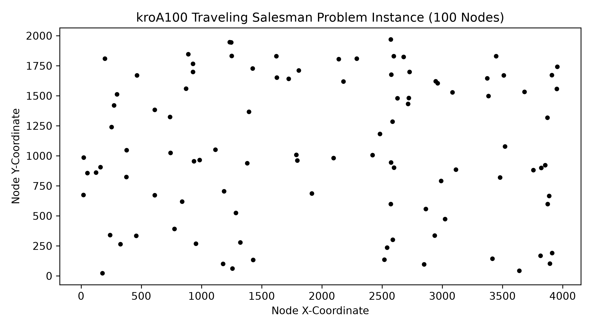
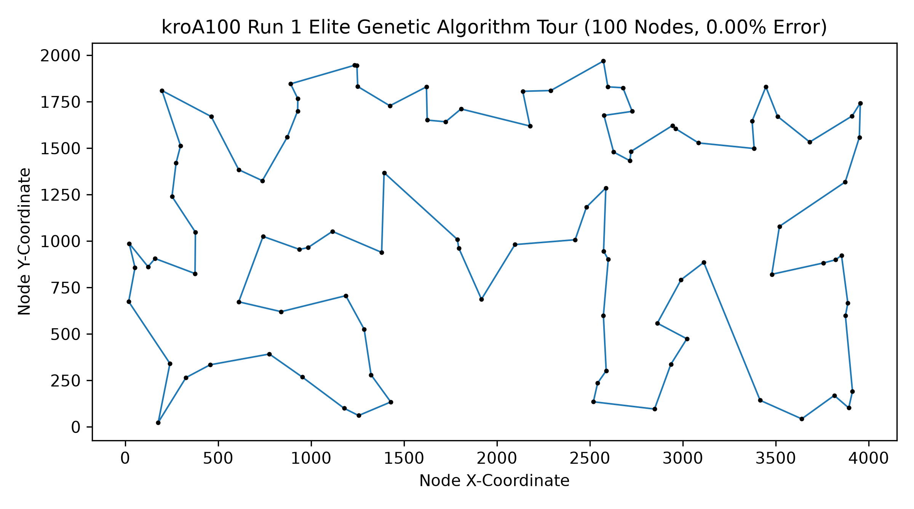
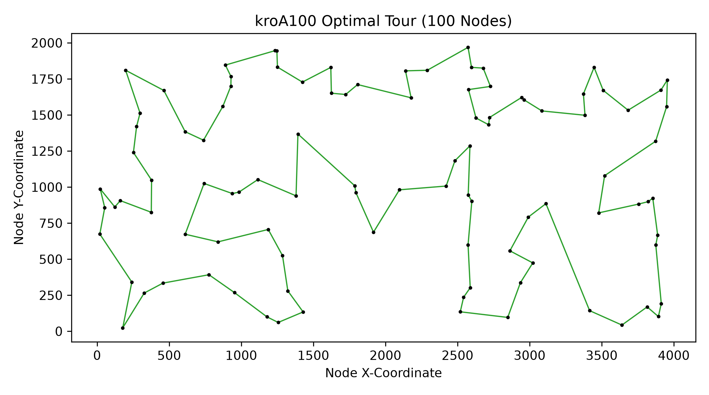
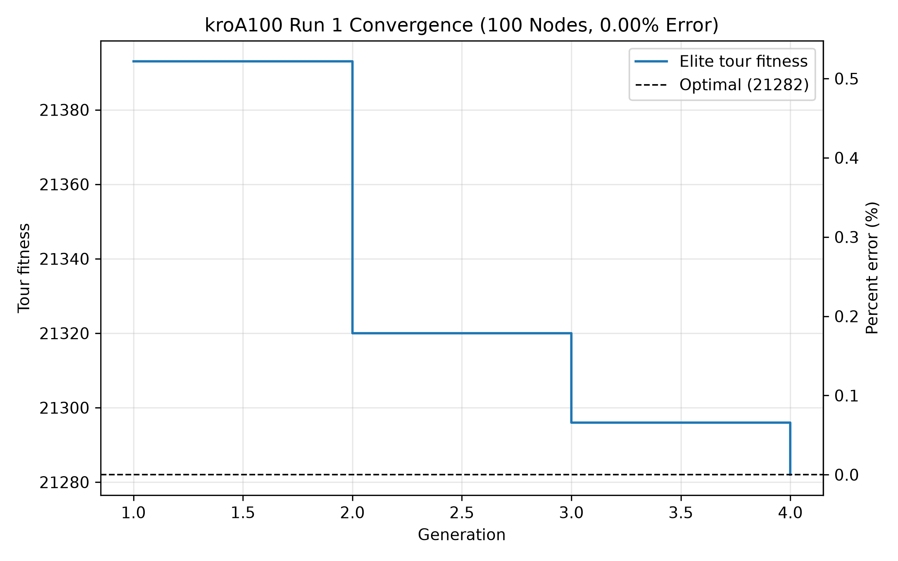

# genetic-algorithm-tsp

A genetic algorithm for the traveling salesman problem.

| Unsolved Instance | Genetic Algorithm's Path |
| --- | --- |
|  |  |

| Optimal Path | Percent Error per Generation |
| --- | --- |
|  |  |

<br>

## Features

* Hybrid genetic algorithm
    * Features
        * 7-tour tournament selection
        * Order crossover
        * 2-node swap mutation
        * 2-opt local search with 16-nearest-neighbor lists
        * Elitism
* Helper tools
    * Sort `EUC_2D` instances from TSPLIB95
    * Plot aggregate percent error vs. node count
    * Plot aggregate compute time vs. node count 
    * Plot aggregate percent error vs. compute time (trade-off)
    * Plot aggregate percent error vs. generation (convergence)
    * Plot individual percent error vs. generation (convergence)
    * Plot individual instance, genetic algorithm tour, and optimal tour

<br>

## Prerequisites

* Windows
* g++ with C++17 and OpenMP support
    * The build tasks use MSYS2 UCRT64 at `C:\msys64\ucrt64\bin\g++.exe`
* Python 3.14 (for helper tools)
* Pip (for helper tools)

<br>

## Running the Genetic Algorithm

1. Verify traveling salesman problem instance path(s) in `res/instances/euc2d/`; paths are built from the project root ([line 93 of `src/main.cpp`](src/main.cpp#L93)), so each instance must be at `res/instances/euc2d/<instance>.tsp` with known optimal tour lengths read from `res/optimal_values.txt`

<br>

2. List traveling salesman problem instance(s) in `INSTANCES_TO_RUN`

    [Line 16 of `src/main.cpp`](src/main.cpp#L16)

    ```cpp
    const std::vector<std::string> INSTANCES_TO_RUN = {
        "kroA100", "pcb442",
    };
    ```

<br>

3. Set the number of runs per instance in `RUNS_PER_INSTANCE` (default 10)

    [Line 29 of `src/main.cpp`](src/main.cpp#L29)

    ```cpp
    const int RUNS_PER_INSTANCE = 10;
    ```

<br>

4. Build in release mode; in VS Code, go to `Terminal` > `Run Task...` > `build (release)`, or from terminal in project root

    ```powershell
    C:\msys64\ucrt64\bin\g++.exe -std=c++17 -O2 -fopenmp -static src\main.cpp src\algorithm.cpp src\instance.cpp -o build\main.exe
    ```

<br>

5. Run; in VS Code, go to `Terminal` > `Run Task...` > `run (release)`, or from terminal in project root

    ```powershell
    .\build\main.exe
    ```

<br>

6. Find the results in `stdout/runs/<instance>/run<N>.txt`

<br>

## Running the Helper Tools