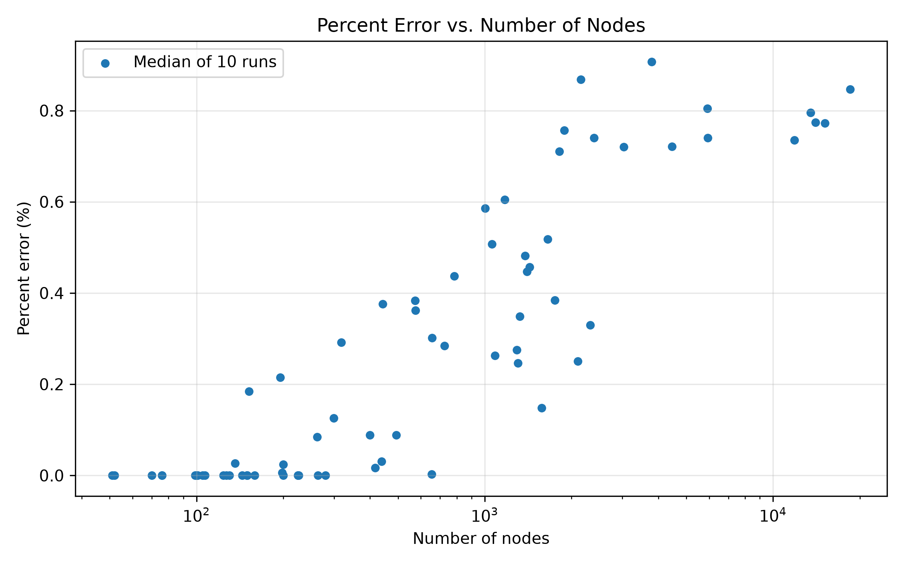
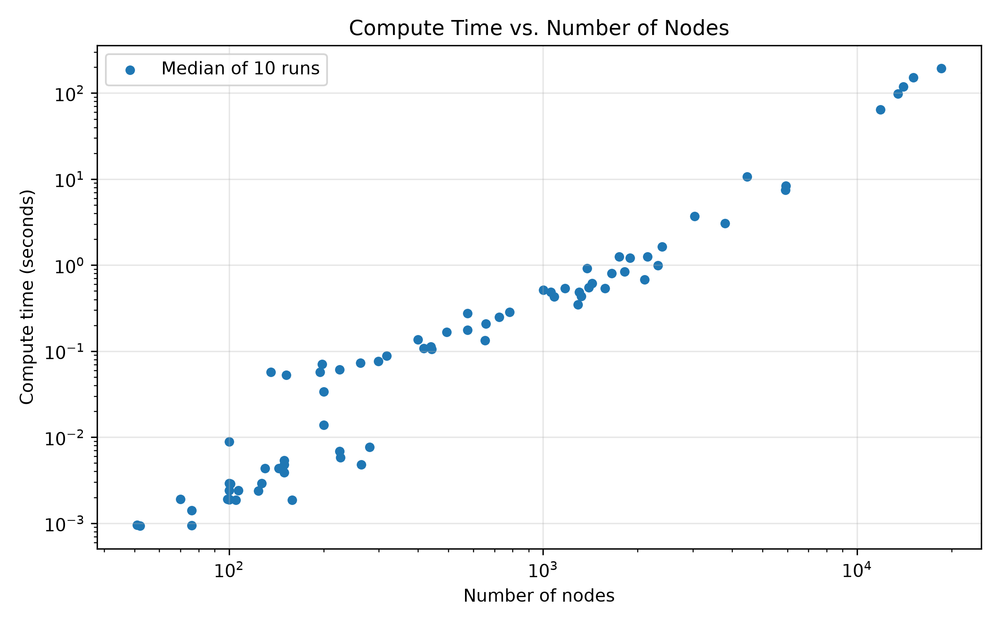
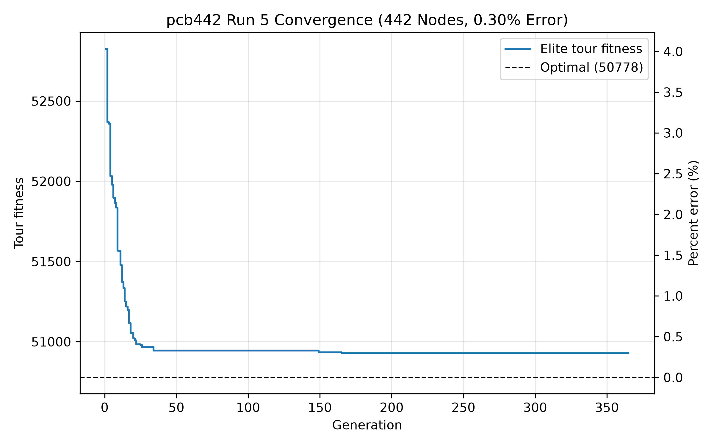
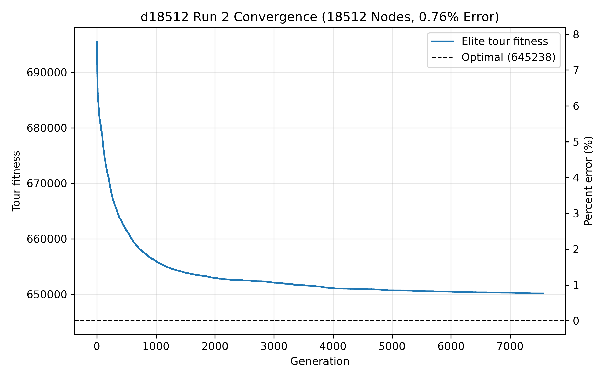
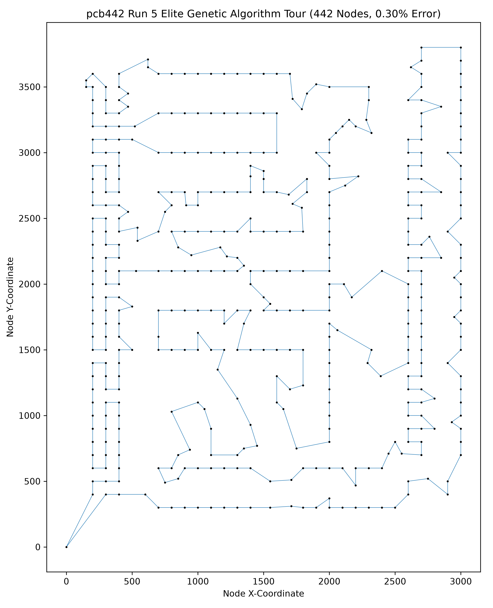
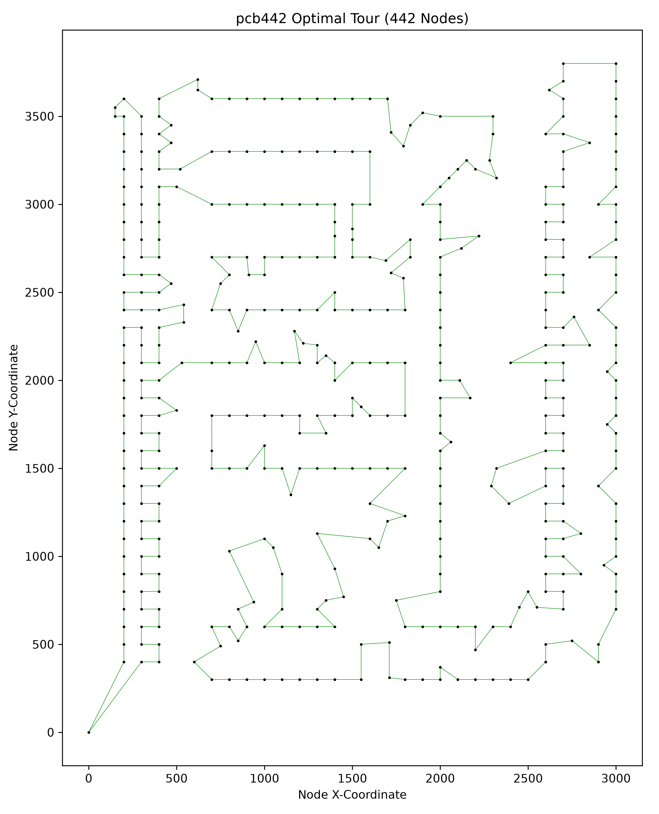
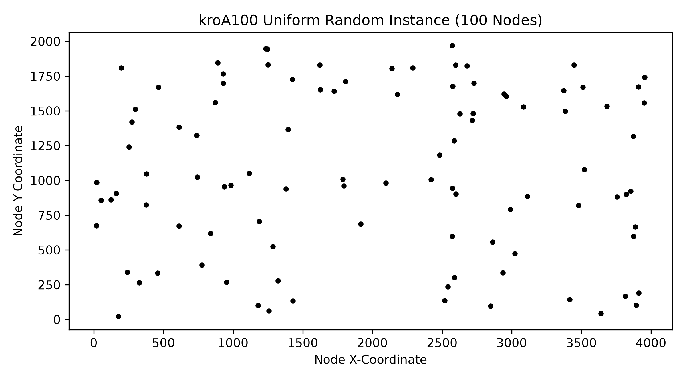
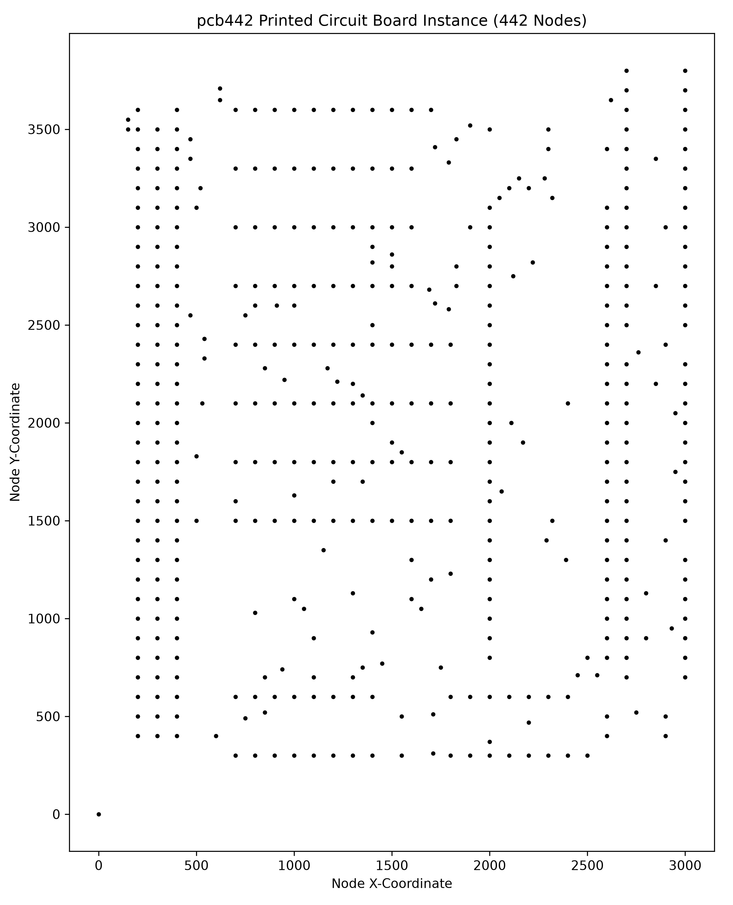
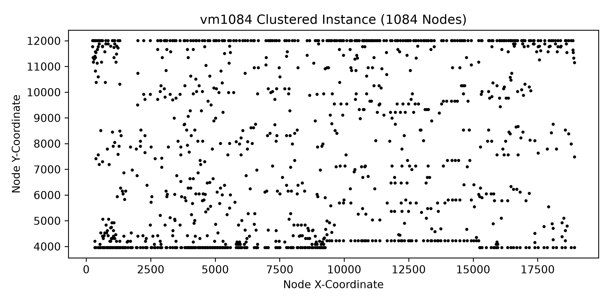
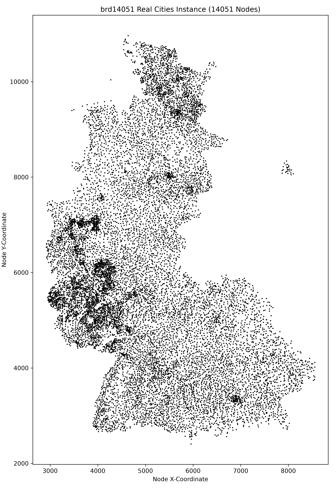

# Genetic Algorithm for the Traveling Salesman Problem

A C++17 genetic algorithm (GA) with 2-opt local search for the symmetric Traveling Salesman Problem, run on all 78 EUC_2D instances from [TSPLIB95](http://comopt.ifi.uni-heidelberg.de/software/TSPLIB95/) (51 to 18,512 nodes). It also includes Python scripts to plot the results.

Across 770 runs (77 instances × 10 runs), the median error is **0.09%** above the known optimum, and the worst run is **4.08%** above it. The GA reached the exact optimum in 315 runs.

## Algorithm

Each generation:

1. **Selection:** tournament selection, picking the best of 7 random tours.
2. **Crossover:** order crossover (OX) with probability 0.85.
3. **Mutation:** one random swap of two nodes, applied to every offspring.
4. **Local search:** 2-opt with 16-nearest-neighbor candidate lists and don't-look bits.
5. **Elitism:** the best tour carries over to the next generation unchanged.

Offspring are generated in parallel with OpenMP. A run stops when it finds the optimum, when the best tour has not improved for 200 generations, or after 10,000 generations.

| Parameter | Value |
| --- | --- |
| Population size | 200 |
| Tournament size | 7 |
| Crossover rate | 0.85 |
| Mutation rate | 1.0 |
| Convergence window | 200 generations |
| Max generations | 10,000 |
| Neighbor list size | 16 |

These values are set in [src/algorithm.h](src/algorithm.h) and [src/instance.h](src/instance.h).

## Repository Layout

```text
src/            C++ GA: instance loading, algorithm, batch runner (main.cpp)
tools/          Python scripts to load runs and plot results
res/instances/  TSPLIB .tsp files (euc2d/ is used; other/ holds non-EUC_2D instances)
res/optimal_tours/      Known optimal tours (.opt.tour) for some instances
res/optimal_values.txt  Known optimal tour lengths
data/runs/      Committed results: 10 runs for each of 77 instances
data/plots/     Committed plots
stdout/         Output folder for new runs and plots (git-ignored)
```

## Prerequisites

- **C++:** g++ with C++17 and OpenMP support. The build tasks use MSYS2 UCRT64 at `C:\msys64\ucrt64\bin\g++.exe`.
- **Python:** Python 3.14 and pip.

Python packages ([requirements.txt](requirements.txt)): `tsplib95==0.7.1`, `matplotlib==3.11.2`, `numpy==2.5.4`.

## Setup

```bash
python -m venv .venv
.\.venv\Scripts\activate
python -m pip install --upgrade pip
pip install -r requirements.txt
```

## Running the GA

1. In [src/main.cpp](src/main.cpp), uncomment the instances you want in `INSTANCES_TO_RUN`. Set `RUNS_PER_INSTANCE` to change the number of runs per instance (default 10).
2. Build and run. In VS Code, use the **run (release)** task. From a terminal:

   ```bash
   g++ -std=c++17 -O2 -fopenmp -static src/*.cpp -o build/main.exe
   ./build/main.exe
   ```

Each run is written to `stdout/runs/<instance>/run<N>.txt`. The file contains a header (dimension, optimum, best length, compute time, percent error), the best length at each generation, and the final tour.

> Running all 78 instances takes several hours. About 88% of that time is spent on the five largest instances.

## Plotting

The plot scripts read from `data/runs/` and save PNG and SVG files to `stdout/plots/`. To plot new results, copy them from `stdout/runs/` into `data/runs/` first.

| Script | Output |
| --- | --- |
| `tools/plot_error_v_dimension.py` | Median percent error vs. number of nodes |
| `tools/plot_time_v_dimension.py` | Median compute time vs. number of nodes |
| `tools/plot_error_v_time.py` | Median percent error vs. compute time |
| `tools/plot_error_v_generation.py` | Percent error vs. generation for every run |
| `tools/plot_single_convergence.py <run file>` | Best tour length over generations for one run |
| `tools/plot_single_tour.py <run file>` | Instance nodes, GA tour, and optimal tour (when available) |

```bash
python tools/plot_error_v_dimension.py
python tools/plot_single_tour.py data/runs/pcb442/run5.txt
```

`tools/sort_euc2d.py` moves EUC_2D instances from `res/instances/other/` to `res/instances/euc2d/`. `tools/load_runs.py` is the shared run-file parser used by the plot scripts.

## Results

All results come from [data/runs/](data/runs/). `linhp318` is left out of the analysis because its listed optimum is for a variant of the problem with fixed edges.

| Nodes | Runs | Median error | Worst error | Optimal runs | Median time |
| --- | --- | --- | --- | --- | --- |
| < 200 | 270 | 0.00% | 0.39% | 228 | 0.003 s |
| 200 – 999 | 210 | 0.03% | 0.74% | 86 | 0.09 s |
| 1,000 – 4,999 | 220 | 0.50% | 4.08% | 1 | 0.79 s |
| ≥ 5,000 | 70 | 0.79% | 1.43% | 0 | 96 s |

Instances below about 300 nodes are usually solved to optimality. Error levels off below 1% for the largest instances. Compute time grows roughly as a power law with instance size, reaching about 3 minutes per run for d18512.

### Error and Time vs. Instance Size






### Convergence

Small instances converge within a few generations. The largest ones keep improving slowly for thousands of generations.


| pcb442, run 5 (0.30% error) | d18512, run 2 (0.76% error) |
| --- | --- |
|  |  |

### Example Tour: pcb442

| GA tour (0.30% error) | Optimal tour |
| --- | --- |
|  |  |

### Instance Types

| Uniform random (kroA100) | Printed circuit board (pcb442) |
| --- | --- |
|  |  |
| **Clustered (vm1084)** | **Real cities (brd14051)** |
|  |  |
