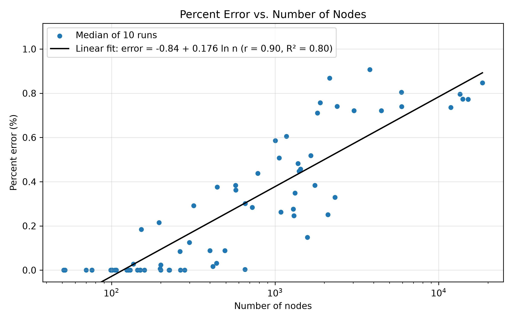
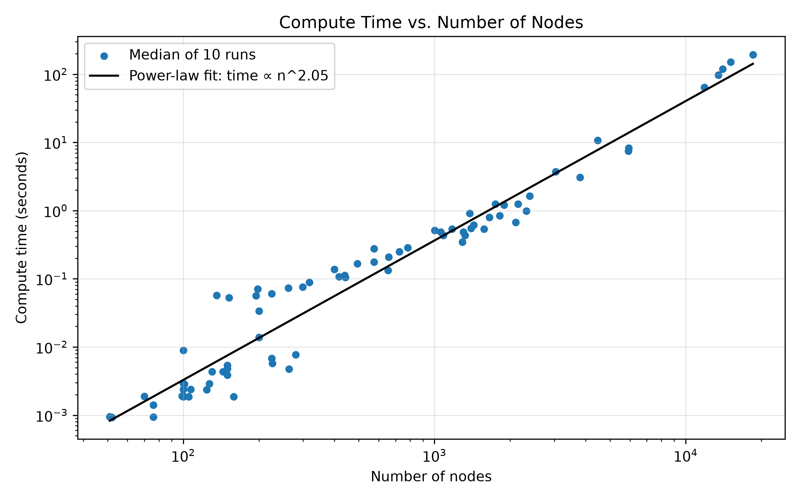
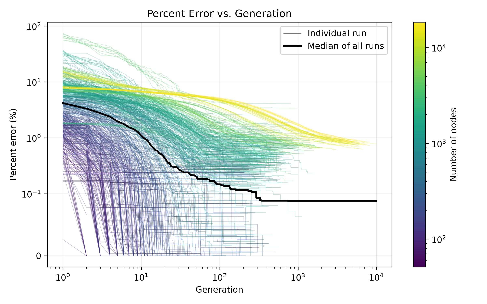
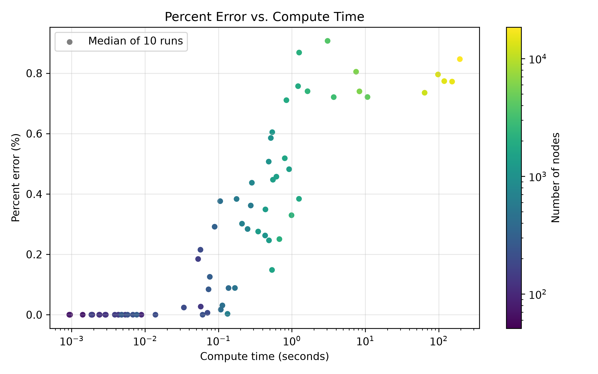

# Rationale and Results

## Rationale

This project was created because the traveling salesman problem is an NP-hard problem with no single, fast algorithmic solutions. However, John Holland's schema theorem provides a theoretical foundation for stochastic heuristics. Subsequently, I sought to measure the effectiveness of a genetic algorithm implementation in finding optimal solutions to the Euclidean 2D traveling salesman problem.

 

## Results

Ultimately, I found that the hybrid genetic algorithm produces near-optimal tours from 51 to 18,512 nodes, but its compute time grows roughly quadratically.

Each of 77 TSPLIB95 `EUC_2D` instances was run 10 times and compared against Concorde's proven-optimal tour lengths (`linhp318` was excluded, as its optimal value applies to a constrained variant). Results are medians of the 10 runs.

 

### Summary

* All 77 instances had a median error below 1%; the worst was 0.91% on `fl3795`.
* Every instance under 100 nodes was solved optimally in every run.
* 42 instances reached the optimum at least once, and 24 reached it in all 10 runs.
* Only 26 of 770 runs ended above 1% error.
* Median compute time ranges from about 1 ms (`eil51`) to 194 s (`d18512`).

 

### Percent Error vs. Number of Nodes

Error grows logarithmically, $\text{error} \approx -0.84 + 0.176 \ln n$ ($r = 0.90$, $R^2 = 0.80$), or about 0.4 percentage points per tenfold increase in nodes. This is far slower than the hypothesized $O(n \log n)$. Above 10,000 nodes, error levels off at 0.74–0.85%, likely because every kept tour is 2-optimal, and 2-optimal Euclidean tours stay within a few percent of optimal regardless of size.

 

### Compute Time vs. Number of Nodes

Compute time follows a power law, $\text{time} \propto n^{2.05}$, consistent with the quadratic hypothesis; above 1,000 nodes the exponent rises to 2.18. The spread below 300 nodes comes from the stopping rule, as runs that reach the optimum stop immediately.

 

### Percent Error vs. Generation

Small instances converge within tens of generations, while the largest improve slowly for thousands before stagnating near 0.8%. Larger instances need both more generations and more time per generation.

 

### Percent Error vs. Compute Time

Runs under 10 ms are solved optimally. Beyond about 1 s, error stays at 0.7–0.9% while time grows by over two orders of magnitude.

 

### Limitations

* Fixed hyperparameters likely understate performance on larger instances.
* The 200-generation stagnation window may stop larger instances prematurely.
* Timings come from a single machine (AMD Ryzen 5 5600, 16 GB DDR4).
* Instance structure is confounded with size; clustered instances like `fl3795` have the highest errors.